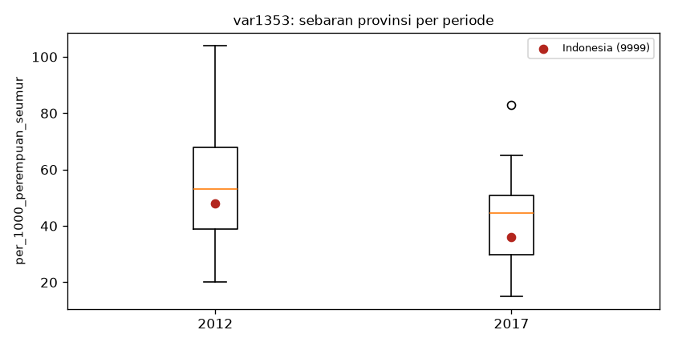
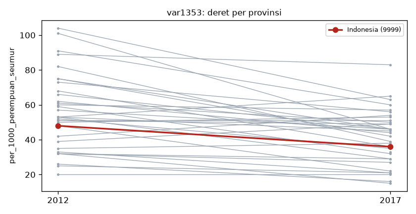
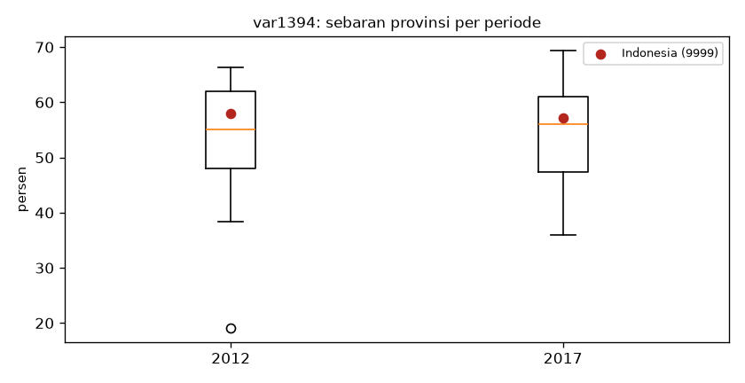
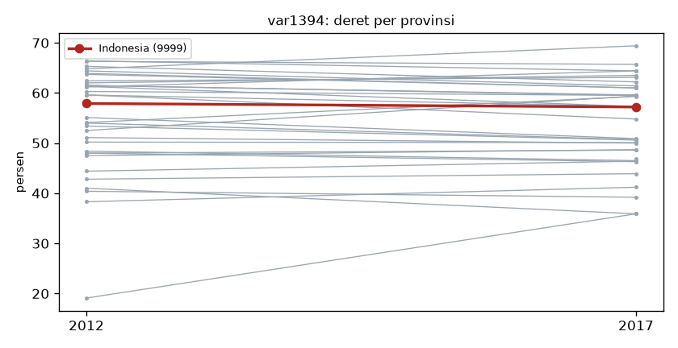

# Profil dan calon anomali seri utama

Dihasilkan `python pipeline.py` (`src/silver/profil.py`). Hanya baris provinsi deret utama (rincian `total`, atau rincian yang didaftar di `DERET` untuk seri yang terbit per rincian; label `kode [rincian]`); baris Indonesia ditampilkan terpisah dan tidak ikut statistik antarprovinsi.

## Banyak periode per provinsi (menentukan arah pembanding)

| seri_kode | min_periode_per_provinsi | maks_periode_per_provinsi |
|---|---|---|
| var1353 | 1 | 2 |
| var1394 | 1 | 2 |

- var1353: hanya arah ke bawah dan perubahan (periode per provinsi 1–2)
- var1394: hanya arah ke bawah dan perubahan (periode per provinsi 1–2)

Metode: IQR dengan pengali 1.5; arah ke samping hanya bila satu provinsi punya paling sedikit 6 periode. Sel yang ditandai lebih dari satu arah ditulis satu baris. Provinsi yang di luar batas ke bawah pada ≥ 50% periode diberi tanda `berulang`: itu perbedaan struktural antarprovinsi, bukan kejadian satu tahun. Lihat log untuk alasan memilih IQR.

## Statistik deskriptif per seri per periode (provinsi)

| seri_kode | periode | n | rerata | simpangan | minimum | q1 | median | q3 | maksimum |
|---|---|---|---|---|---|---|---|---|---|
| var1353 | 2012 | 33 | 56.06 | 21.79 | 20.00 | 39.00 | 53.00 | 68.00 | 104.00 |
| var1353 | 2017 | 34 | 41.71 | 15.57 | 15.00 | 29.75 | 44.50 | 50.75 | 83.00 |
| var1394 | 2012 | 33 | 54.32 | 10.47 | 19.10 | 48.00 | 55.10 | 62.00 | 66.40 |
| var1394 | 2017 | 34 | 53.96 | 8.94 | 35.90 | 47.33 | 56.05 | 61.00 | 69.40 |

## Baris Indonesia

| seri_kode | periode | nilai | rujukan_tahun |
|---|---|---|---|
| var1394 | 2012 | 57.90 | <NA> |
| var1394 | 2017 | 57.20 | <NA> |
| var1353 | 2012 | 48.00 | <NA> |
| var1353 | 2017 | 36.00 | <NA> |

## Calon anomali (3)

Daftar lengkap di `reports/calon-anomali.csv`; kategorinya di `reports/anomali.csv`.

| seri_kode | wilayah_kode | nama_wilayah | periode | nilai | arah | alasan | berulang |
|---|---|---|---|---|---|---|---|
| var1353 | 6200 | Kalimantan Tengah | 2017 | 83.00 | ke bawah | di luar [-1.75, 82.25] (IQR x 1.5) dibanding 34 provinsi tahun itu | False |
| var1394 | 9400 | Papua | 2012 | 19.10 | ke bawah | di luar [27.00, 83.00] (IQR x 1.5) dibanding 33 provinsi tahun itu | False |
| var1394 | 9400 | Papua | 2017 | 35.90 | perubahan | perubahan 2012→2017 sebesar +16.80 di luar [-8.80, 7.20] | False |

## Gambar

